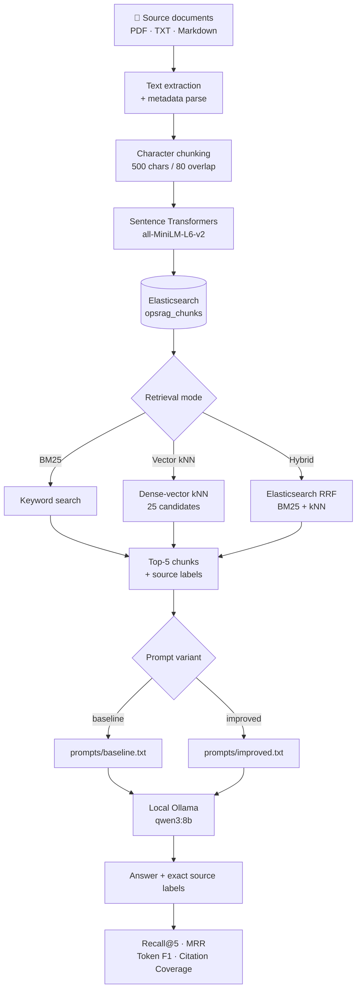

<h1 align="center">OpsRAG</h1>

<p align="center">
  Operations knowledge retrieval and evaluation lab — every pipeline stage explicit, inspectable, and independently testable.
</p>

<p align="center">
  
  
  
  
  
  
  
</p>

---

OpsRAG treats a RAG pipeline as eight separable stages — extraction, chunking, embedding, indexing, retrieval, prompting, generation, evaluation — each in its own Python module, connected by direct calls. There is no LangChain or LlamaIndex dependency. The separation exists so each stage can be read, tested, and replaced independently: change the embedding model with one environment variable, compare BM25 against hybrid retrieval by naming two experiment definitions, and inspect every metric at the row level in the output CSVs.

The project ships BM25, dense-vector kNN, and Elasticsearch-native reciprocal-rank-fusion (RRF) retrieval, grounded generation via local Ollama, source attribution with exact chunk labels, and a 35-question evaluation suite measuring Recall@5, MRR, token F1, and citation coverage.

---

### Quick start

> **Prerequisites:** Python 3.12+, Elasticsearch 9.x running, Ollama with `qwen3:8b` pulled.

```bash
pip install -r requirements.txt
cp .env.example .env                    # edit if ES isn't on http://localhost:9200
python scripts/create_index.py          # creates opsrag_chunks with dense_vector field
python scripts/ingest_documents.py      # indexes the 10 sample notes → 10 chunks
python scripts/evaluate.py --limit 3   # smoke test: both experiments over 3 questions
```

---

## Contents

- [Pipeline](#pipeline)
- [Architecture](#architecture)
- [Repository layout](#repository-layout)
- [Prerequisites](#prerequisites)
- [Setup](#setup)
- [Configuration](#configuration)
- [Evaluation design](#evaluation-design)
- [Corpus](#corpus)
- [Example query](#example-query)
- [Unit tests](#unit-tests)
- [Development verification record](#development-verification-record)
- [Stress-test findings and fixes](#stress-test-findings-and-fixes)
- [Limitations](#limitations)
- [Docs](#docs)

---

## Pipeline



---

## Architecture

Each stage is a named module with a single responsibility.

| Stage | What it does | Location |
|---|---|---|
| Extraction | Reads PDF, TXT, MD; parses optional header metadata | `src/ingestion.py` |
| Chunking | Deterministic character windows | `src/chunking.py` |
| Embeddings | Encodes chunks with Sentence Transformers | `src/embeddings.py` |
| Indexing | Creates `opsrag_chunks` mapping; bulk-indexes chunks | `scripts/create_index.py`, `src/ingestion.py` |
| Retrieval | BM25 keyword, kNN dense-vector, Elasticsearch-native RRF hybrid | `src/retrieval.py` |
| Prompting | Selects and fills the baseline or improved template | `src/prompting.py`, `prompts/` |
| Generation | Calls the local Ollama chat endpoint | `src/generation.py` |
| Evaluation | Computes Recall@5, MRR, token F1, citation coverage | `src/evaluation.py`, `scripts/evaluate.py` |
| UI | Streamlit — **Ask** and **Evaluation** views | `app/streamlit_app.py` |
| Config | Single source of truth for all tuneable values | `src/config.py` |

---

## Repository layout

<details>
<summary><strong>Expand full tree</strong></summary>

```
opsrag/
├── .env.example                ← copy to .env; fill in your connection values
├── .gitignore
├── requirements.txt
├── README.md
│
├── app/
│   └── streamlit_app.py        ← Ask and Evaluation views with sidebar health probe
│
├── data/
│   ├── sample/                 ← 10 original paraphrase notes (public-source)
│   └── evaluation/
│       └── questions.json      ← 35 questions: 34 answerable, 1 unanswerable (q035)
│
├── docs/
│   ├── architecture.md
│   ├── evaluation.md           ← exact metric contract and failure thresholds
│   ├── experiment_log.md
│   └── verification.md         ← development evidence record
│
├── prompts/
│   ├── baseline.txt            ← used by the baseline experiment
│   └── improved.txt            ← used by the improved experiment
│
├── scripts/
│   ├── create_index.py         ← queries embedding dimension; creates index mapping
│   ├── ingest_documents.py
│   └── evaluate.py             ← runs baseline + improved; prints summary table; writes results/
│
├── src/
│   ├── __init__.py
│   ├── chunking.py
│   ├── config.py               ← reads .env at import time; frozen dataclass
│   ├── elasticsearch_client.py ← get_client() and check_connection()
│   ├── embeddings.py
│   ├── evaluation.py
│   ├── generation.py
│   ├── ingestion.py
│   ├── prompting.py
│   └── retrieval.py
│
└── tests/
    ├── conftest.py
    ├── test_chunking.py        ← 11 tests
    ├── test_evaluation.py      ← 28 tests
    ├── test_generation.py      ← 8 tests
    ├── test_ingestion.py       ← 10 tests
    └── test_retrieval.py       ← 18 tests  (75 total; no live services required)
```

</details>

---

## Prerequisites

| Dependency | Required version | Role |
|---|---|---|
| Python | 3.12+ | Runtime |
| Elasticsearch | 9.x (tested: 9.5.4) | Search and vector index |
| Ollama | any recent | Local LLM server; model must be pulled before use |
| `elasticsearch` | ==9.5.1 | Official Python client |
| `sentence-transformers` | ==6.1.0 | Encoding (default: `all-MiniLM-L6-v2`) |
| `ollama` | ==0.6.2 | Python SDK for Ollama |
| `streamlit` | >=1.50,<2 | UI |
| `pandas` | >=2.2,<3 | Result handling |
| `pypdf` | >=6,<7 | PDF extraction |
| `python-dotenv` | ==1.2.3 | `.env` loading |
| `pytest` | >=8,<10 | Test suite only |

---

## Setup

### 1 · Create the virtual environment

**Windows (PowerShell)**
```powershell
py -3.12 -m venv .venv
.\.venv\Scripts\Activate.ps1
python -m pip install --upgrade pip
pip install -r requirements.txt
```

**macOS / Linux**
```bash
python3.12 -m venv .venv
source .venv/bin/activate
python -m pip install --upgrade pip
pip install -r requirements.txt
```

---

### 2 · Configure Elasticsearch and Ollama

```bash
cp .env.example .env          # Windows: Copy-Item .env.example .env
```

The HTTP loopback defaults work out of the box when Elasticsearch is running without authentication. For HTTPS or API-key installations, set the relevant variables — see [Configuration](#configuration) below.

Pull the Ollama model before anything that calls the generation stage:

```bash
ollama pull qwen3:8b     # development default
# lighter alternative, also verified:
ollama pull qwen3:4b
```

---

### 3 · Create the Elasticsearch index

```bash
python scripts/create_index.py
```

Reads `EMBEDDING_MODEL` from `.env`, requests the output dimension from Sentence Transformers, and creates the `opsrag_chunks` index with a matching `dense_vector` field.

---

### 4 · Ingest the sample corpus

```bash
python scripts/ingest_documents.py
```

Processes all `.pdf`, `.txt`, and `.md` files in `data/sample/`. A successful run on the default corpus reports:

```
10 documents | 10 chunks | 10 indexed | 0 failures
```

**To add your own documents**, place `.pdf`, `.txt`, or `.md` files into `data/sample/`. For TXT and Markdown files, these optional header fields are parsed from the top of the file. Blank lines between header fields are tolerated:

```
TITLE:   Document title
SOURCE:  https://source-url
TOPIC:   emergency planning
SECTION: Operations

Body text starts here after the headers.
```

---

### 5 · Run the evaluation

Smoke test (first 3 questions only):
```bash
python scripts/evaluate.py --limit 3
```

Full run over all 35 questions:
```bash
python scripts/evaluate.py
```

Both experiments run in a single pass. Per-question progress is printed to stdout as each question completes, followed by a summary table:

```
[baseline] method=BM25  prompt=baseline  questions=35
    1/35  q001  recall=   1.0  f1=0.612  cite=1.00  [none]
    2/35  q002  recall=   1.0  f1=0.444  cite=1.00  [incomplete answer]
  ...

[improved] method=Hybrid  prompt=improved  questions=35
  ...

Experiment          Recall@5                   MRR     Answer Correctness   Citation Coverage
------------------------------------------------------------------------
baseline          0.XXXX              0.XXXX              0.XXXX              0.XXXX
improved          0.XXXX              0.XXXX              0.XXXX              0.XXXX

Full per-question results: results/baseline.csv · results/improved.csv
```

Results are written to `results/` (excluded by `.gitignore`):

```
results/
├── baseline.csv   ← BM25 + prompts/baseline.txt
├── improved.csv   ← Hybrid RRF + prompts/improved.txt
└── summary.csv
```

---

### 6 · Run the unit tests

```bash
pytest -q
```

No live Elasticsearch node or Ollama service required. All 75 tests run against fake clients and deterministic functions.

---

### 7 · Start the Streamlit UI

```bash
streamlit run app/streamlit_app.py
```

Opens at `http://localhost:8501`.

The sidebar shows a live connection probe against Elasticsearch on every page load, the count of indexed chunks, and the configured embedding and LLM model names.

- **Ask** — submit a query, select BM25 / Vector / Hybrid, see the answer with sources and the raw retrieved chunks (chunk ID, score, title, section, and source URL where available)
- **Evaluation** — reads CSVs from `results/` and displays aggregate metrics, failure-category frequency, and a per-question drill-down in tabbed baseline/improved views (requires a completed evaluation run)

---

## Configuration

All tuneable values live in `.env`. `src/config.py` reads them at import time into a frozen dataclass; no tuning is done by editing source files.

```dotenv
# ── Elasticsearch ─────────────────────────────────────────────────────────────
ELASTICSEARCH_URL=http://localhost:9200   # point at your server
ELASTICSEARCH_API_KEY=                    # leave blank when using user/pass
ELASTICSEARCH_USERNAME=
ELASTICSEARCH_PASSWORD=
ELASTICSEARCH_CA_CERT=                    # path to local CA; never committed to Git
ELASTICSEARCH_VERIFY_CERTS=true
ELASTICSEARCH_INDEX=opsrag_chunks         # index name used throughout

# ── Embeddings and generation ─────────────────────────────────────────────────
EMBEDDING_MODEL=sentence-transformers/all-MiniLM-L6-v2
OLLAMA_HOST=http://localhost:11434
OLLAMA_MODEL=qwen3:8b                     # must be pulled locally before use

# ── Retrieval and chunking ────────────────────────────────────────────────────
CHUNK_SIZE=500                            # characters per chunk
CHUNK_OVERLAP=80                          # character overlap between adjacent chunks
TOP_K=5                                   # chunks returned per query
VECTOR_NUM_CANDIDATES=25                  # kNN candidate pool before scoring to TOP_K
```

> **`ELASTICSEARCH_CA_CERT`** is kept in `.env` so a certificate path never enters the repository. `.gitignore` already excludes `.env`.

---

## Evaluation design

The evaluation script runs two named experiment definitions over the same 35-question set.

### Experiments

| Experiment | Retrieval | Prompt template |
|---|---|---|
| `baseline` | BM25 | `prompts/baseline.txt` |
| `improved` | Hybrid RRF | `prompts/improved.txt` |

This is a controlled comparison of retrieval mode and prompt template inside the same corpus and generation pipeline. It is not a claim about which configuration is universally better.

### Metrics

| Metric | What it measures | Unanswerable `q035` |
|---|---|---|
| **Recall@5** | Whether expected relevant chunk IDs appear in the first 5 results | Omitted |
| **MRR** | Reciprocal rank of the first relevant chunk | Omitted |
| **Answer Correctness** | Token-level F1 between generated and reference answers — no second-model evaluator | Included |
| **Citation Coverage** | Whether source labels from retrieved relevant chunks appear (case-insensitively) in the answer | Satisfied only by an explicit insufficient-evidence refusal |

### Failure diagnostic labels

A single result row can carry multiple labels. These are project diagnostics with explicit thresholds, not externally validated quality gates.

| Label | Condition |
|---|---|
| `irrelevant retrieval` | Answerable question with Recall@5 = 0 |
| `missing evidence` | Answerable question with Recall@5 < 1 |
| `unsupported answer` | Token F1 < 0.5 |
| `incomplete answer` | Answerable question with token F1 < 0.75 |
| `wrong source` | Answerable question with zero citation coverage |

---

## Corpus

`data/sample/` contains 10 short original paraphrase notes. Each carries a `SOURCE:` header referencing the public document it condenses. The notes are sized near the 500-character chunk ceiling to keep chunk-boundary behaviour observable.

**Topics covered:**

| Domain | Coverage |
|---|---|
| Emergency Operations Centers (EOC) | ✓ |
| Incident Command System (ICS) | ✓ |
| National Incident Management System (NIMS) | ✓ |
| Incident Action Planning (IAP) | ✓ |
| Resource management | ✓ |
| Emergency communications (including NECP) | ✓ |
| ICS forms | ✓ |
| Plain-language public-safety communications | ✓ |

`data/evaluation/questions.json` contains **35 questions** with **37 total relevant-chunk references** across the 34 answerable items (some multi-source questions reference more than one expected chunk). One question (`q035`) is deliberately unanswerable — it covers an inventory detail absent from the corpus, testing whether the pipeline refuses rather than fabricates.

The set includes both single-source questions (one relevant chunk) and multi-source questions (multiple relevant chunks across different notes), so retrieval precision and recall can be evaluated independently of generation quality.

---

## Example query

```
What are the goals of the National Emergency Communications Plan?
```

The expected retrieval path is the NECP chunk. When retrieved and cited, the answer should carry a source label of the form:

```
[National Emergency Communications Plan — NECP goals]
```

The exact generated prose varies with the local Ollama model and its configuration. The repository does not treat any generated example as a benchmark result.

---

## Unit tests

Tests require no live Elasticsearch node or Ollama service. Retrieval tests use a fake `FakeClient`; evaluation metric tests are fully deterministic.

| File | Tests | What it covers |
|---|---|---|
| `test_chunking.py` | 11 | Character windowing, overlap, NUL-byte cleaning, unicode, sequential IDs |
| `test_evaluation.py` | 28 | Recall@5, MRR, token F1, citation coverage, failure labels, summarize, evaluate_item |
| `test_generation.py` | 8 | Source label insertion, case-insensitive dedup, empty answer, missing section key |
| `test_ingestion.py` | 10 | Metadata parsing, blank-line tolerance, filename normalisation, error on unsupported type |
| `test_retrieval.py` | 18 | BM25/kNN/RRF request construction, case-insensitive dispatch, num_candidates floor, client lifecycle |
| **Total** | **75** | |

Run the full suite:

```bash
pytest -q
```

Expected output:

```
75 passed in 0.xx s
```

---

## Development verification record

Concrete observations from the project build. Live results depend on the local Elasticsearch index, embedding model, Ollama model, and runtime environment.

| Observation | Recorded value |
|---|---|
| Elasticsearch server version | 9.5.4 |
| Elasticsearch Python client version | 9.5.1 |
| Sample ingestion result | 10 documents, 10 chunks, 10 indexed, 0 failures |
| ES `count` after ingestion | 10 |
| BM25 top result for `emergency communications` | `emergency_communications-c0001` |
| Vector top result for `emergency communications` | `plain_language_comms` first; `emergency_communications` in result set — different ranking order from BM25 on the same corpus |
| Hybrid probe result | `emergency_communications-c0001` |
| Ollama generation check | HTTP 200 with `qwen3:4b` configured |
| Test suite after improvements | 75 tests, 0 failures, 0.29 s |

---

## Stress-test findings and fixes

A systematic stress test was run against every module after initial development. Three bugs were found and fixed.

### Bugs fixed

<details>
<summary><strong>BUG-3 · <code>_parse_text_metadata</code>: blank lines between header fields ended parsing early</strong></summary>

**What broke:** Any blank line in the header block — including natural spacing like `TITLE: Doc\n\nSOURCE: url` — triggered `header_done = True`, pushing the remainder of the header fields into the document body. `SOURCE`, `TOPIC`, and `SECTION` were silently lost.

**Verified with:**
```python
# Before fix
doc = extract_document(path_with_blank_gap)
doc.source  # → 'filename.txt'  ← filename fallback, not the declared URL
```

**Fix in `src/ingestion.py`:** Blank lines inside the header block are now skipped rather than treated as body lines. Only a non-blank, non-header line terminates header parsing.

```python
if not header_done and stripped == "":
    continue  # blank line inside header block — skip, don't end the section
header_done = True
remaining.append(line)
```

**Covered by:** `test_blank_line_between_metadata_headers_is_tolerated`, `test_multiple_blank_lines_between_all_header_fields`

</details>

<details>
<summary><strong>BUG-1 · <code>_ensure_source_citations</code>: duplicate source label when label already in prose</strong></summary>

**What broke:** If a source label appeared in the answer prose body (`"The answer uses [Doc A — Sec 1] inline."`) but no `Sources:` line existed, the function still appended a `Sources:` block — producing `[Doc A — Sec 1]` twice in the same response. The `citation_coverage` metric uses a case-insensitive substring check, so the extra block did not improve scores; it only added noise.

**Fix in `src/generation.py`:** The "missing" check now uses `.lower()` on both sides (matching `citation_coverage`), and early-returns as soon as all labels are found anywhere in the answer — regardless of whether a `Sources:` line is present.

```python
answer_lower = answer.lower()
missing = [label for label in labels if label.lower() not in answer_lower]
if not missing:
    return answer  # all labels already present; nothing to add
```

**Covered by:** `test_label_already_in_prose_body_is_not_duplicated`, `test_label_check_is_case_insensitive`

</details>

<details>
<summary><strong>BUG-4 · <code>retrieve()</code>: method string was case-sensitive</strong></summary>

**What broke:** `retrieve("query", "bm25")` raised `ValueError: Unknown retrieval method: 'bm25'`. The function required exact capitalisation (`"BM25"`, `"Vector"`, `"Hybrid"`). The Streamlit UI used the exact strings so production was unaffected, but any programmatic caller using lowercase was silently broken.

**Fix in `src/retrieval.py`:** A `_METHOD_MAP` dictionary keyed on `method.strip().lower()` replaces the three `if` branches. The error message now lists the valid values.

```python
fn = _METHOD_MAP.get(method.strip().lower())
if fn is None:
    raise ValueError(
        f"Unknown retrieval method: {method!r}. Valid values: BM25, Vector, Hybrid."
    )
```

**Covered by:** `test_retrieve_is_case_insensitive_for_bm25` (4 parametrized variants), `test_retrieve_is_case_insensitive_for_vector` (3), `test_retrieve_is_case_insensitive_for_hybrid` (3), `test_retrieve_unknown_method_raises_value_error`

</details>

### Confirmed-correct behaviours (not bugs)

| Observation | Why it is correct |
|---|---|
| `recall_at_k([], []) == 1.0` | Standard convention: no relevant documents means retrieval trivially satisfies the set. `q035` (unanswerable) never calls this path. |
| `failure_category` fires both `irrelevant retrieval` and `missing evidence` when `recall5 == 0` | Documented redundancy: `recall5=0` is a strict subset of `recall5<1`. Both labels are intentional to allow filtering on either threshold. |
| `_ensure_source_citations` appends missing labels to an existing `Sources:` line rather than replacing it | Additive behaviour is correct: the model may have cited a source not in the retrieved set; discarding it would reduce coverage for the citation check. |
| `token_f1("", "") == 1.0` | Vacuously true: an empty prediction against an empty reference has no missing or spurious tokens. |
| `summarize()` includes the unanswerable question's `answer_correctness` in the aggregate | By design: a correct refusal scores high on token F1 against its reference answer. This is a feature of the project's evaluation contract. |

### Improvements shipped alongside the fixes

| Area | What changed |
|---|---|
| `app/streamlit_app.py` | Sidebar now calls `check_connection()` on every page load and shows a ✅/🔴 status with the indexed chunk count. Error messages in the Ask view now expose the exception type and message via an expandable "Error details" block. Retrieved chunks display score, title, section, and source URL. Evaluation view adds a per-question drill-down in tabbed baseline/improved views. |
| `scripts/evaluate.py` | Prints per-question progress (`recall`, `f1`, `cite`, `failure_category`) as each question completes, followed by a formatted summary table at the end — so results are visible without opening any CSV file. |

---

## Limitations

**Corpus size:** 10 short notes, each near the 500-character chunk ceiling. Useful for observing pipeline behaviour; not representative of a production knowledge base.

**Lexical metrics only:** token F1 does not replace human evaluation. Citation coverage verifies that a source label string appears in the answer — it does not confirm that the cited passage supports the claim. Failure labels are diagnostic thresholds set during development, not externally validated quality gates.

**Retrieval sensitivity:** Recall@5 and MRR vary with chunk boundaries, the embedding model named in `EMBEDDING_MODEL`, and the contents of the live index at run time. The verification record captures one run.

**No licence:** the repository was published without a licence file. Reuse terms are not established.

---

## Docs

| Document | Contents |
|---|---|
| [`docs/architecture.md`](docs/architecture.md) | System design notes |
| [`docs/evaluation.md`](docs/evaluation.md) | Exact metric contract: definitions, failure thresholds, output file format |
| [`docs/experiment_log.md`](docs/experiment_log.md) | Notes from the development experiment runs |
| [`docs/verification.md`](docs/verification.md) | Full development evidence record |

---

<details>
<summary><strong>Publishing to GitHub</strong></summary>

From the repository root, after creating an empty repository on GitHub:

```bash
git init -b main
git add .
git commit -m "Initial OpsRAG repository"
git remote add origin <your-repository-url>
git push -u origin main
```

With GitHub CLI:

```bash
gh repo create opsrag --source . --remote origin --push
```

Keep `.env`, certificate files, locally generated `results/` CSVs, and Ollama model files out of the commit. `.gitignore` already excludes these.

</details>
